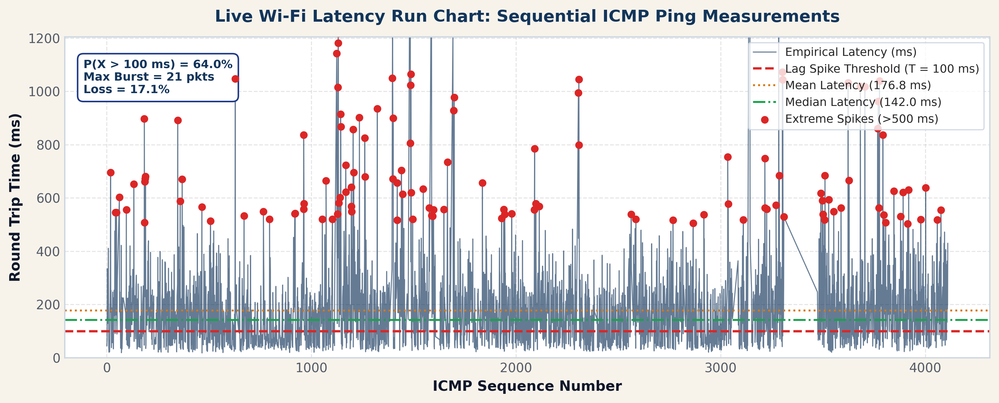
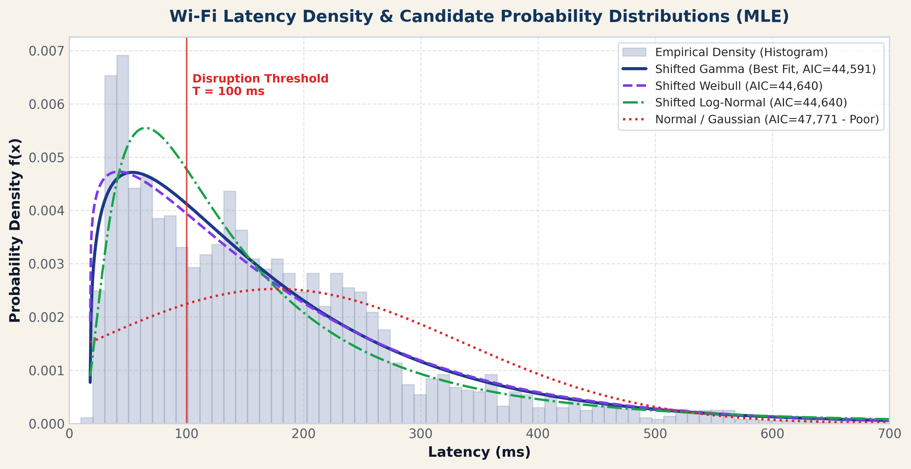
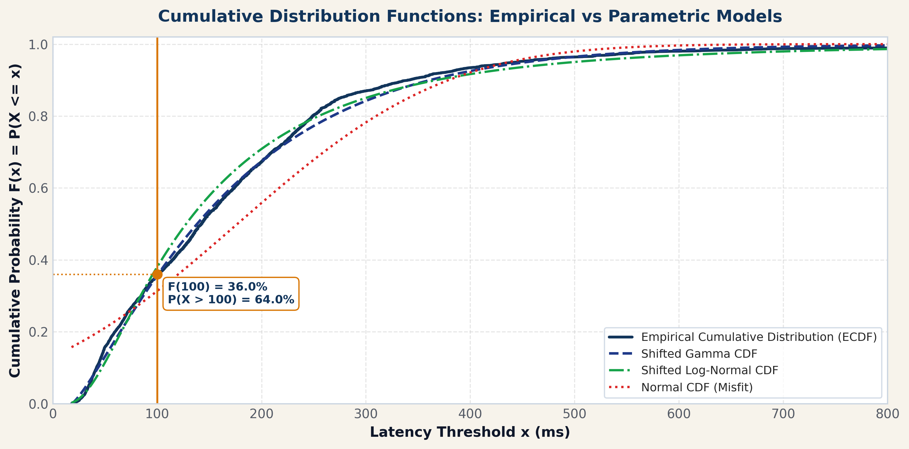
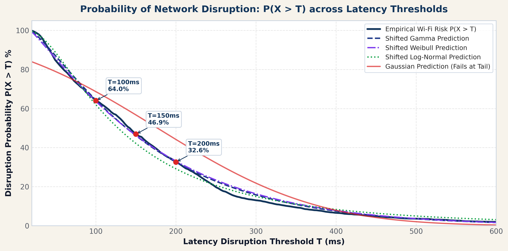

# The Probability of a Lag Spike: Statistical Modeling & Solution for Wi-Fi Latency

[](https://www.python.org/downloads/)
[](https://opensource.org/licenses/MIT)
[]()

An empirical, data-driven statistical analysis and parametric modeling pipeline investigating network latency distributions, tail risk, and packet disruption in Wi-Fi environments.

---

## 📌 Executive Summary

Standard network diagnostics rely almost universally on **mean latency** ("average ping"). However, in real-time digital communications—such as video conferencing, competitive gaming, and financial execution—mean latency is a deceptive metric. In practice, Wi-Fi latency distributions are bounded on the left by physical propagation hardware limits and exhibit severe, volatile right tails.

This repository provides the complete end-to-end 4-step statistical inference workflow executed on live Wi-Fi latency measurements ($N = 3,685$ successful probe replies from a 4,444-packet trace):

1. **Exploratory Data Analysis (EDA):** Mean latency ($176.81\text{ ms}$) is heavily skewed by extreme outliers, standing $34.8\text{ ms}$ above the median ($142.00\text{ ms}$). The dataset displays severe positive skewness ($\gamma_1 = +3.560$) and extreme excess kurtosis ($\kappa = +25.996$), with maximum spikes reaching $2,479.0\text{ ms}$ and a $17.08\%$ packet loss rate.
2. **Parametric Distribution Fitting via MLE:** Implements Maximum Likelihood Estimation across candidate families (Shifted Gamma, Shifted Weibull, Shifted Log-Normal, Standard Log-Normal, Shifted Exponential, and Gaussian Normal).
3. **Goodness-of-Fit Testing & Model Selection:** Formally rejects the Gaussian assumption ($D = 0.1603, p = 3.53 \times 10^{-83}$). Identifies the **3-Parameter Shifted Gamma Distribution** as the superior model ($\text{AIC} = 44,590.9, \text{BIC} = 44,609.5, D_{\text{KS}} = 0.0404$).
4. **Disruption Risk Estimation ($P(X > 100\text{ ms})$):** Demonstrates that **$64.04\%$ of packets experience disruption**. The fitted Shifted Gamma model predicts **$64.34\%$** (relative error $< 0.5\%$), confirming high predictive accuracy.
5. **Uncertainty Quantification:** $95\%$ non-parametric bootstrap confidence intervals ($B = 5,000$ iterations) show that while the median is tightly bounded ($\pm 4\text{ ms}$), the 99th percentile spans a volatile range of $[680.0\text{ ms}, 928.0\text{ ms}]$.
6. **Temporal Clustering:** Significant lag-1 autocorrelation ($\rho_1 = +0.270, p < 10^{-15}$) proves that Wi-Fi lag spikes cluster into persistent multi-second bursts.

---

## 📊 Visual Highlights

| Time Series & Anomaly Detection | Distribution Fits (MLE vs KDE) |
|:---:|:---:|
|  |  |

| Empirical CDF vs Candidate Models | Disruption Risk Curve $P(X > x)$ |
|:---:|:---:|
|  |  |

---

## 📈 Model Comparison Summary

| Model | Log-Likelihood | AIC | BIC | KS Statistic ($D$) | KS $p$-value |
| :--- | :--- | :--- | :--- | :--- | :--- |
| **Shifted Gamma (Best)** | **-22,292.4** | **44,590.9** | **44,609.5** | **0.0404** | **$1.01 \times 10^{-5}$** |
| Shifted Weibull | -22,309.2 | 44,624.4 | 44,643.1 | 0.0441 | $1.43 \times 10^{-6}$ |
| Shifted Log-Normal | -22,347.1 | 44,700.2 | 44,718.8 | 0.0526 | $8.07 \times 10^{-9}$ |
| Standard Log-Normal | -22,593.7 | 45,191.4 | 45,203.9 | 0.0883 | $7.67 \times 10^{-25}$ |
| Shifted Exponential | -22,764.1 | 45,532.2 | 45,544.7 | 0.1009 | $3.59 \times 10^{-32}$ |
| Gaussian Normal | -23,439.8 | 46,883.6 | 46,896.0 | 0.1603 | $3.53 \times 10^{-83}$ |

---

## 🛠️ Repository Structure

```
├── WIFI_SOLUTION_REPORT.md       # Comprehensive scientific research & solution report
├── wifi_lag_spike_solution.py    # Main statistical inference & parametric modeling engine
├── build_presentation.py         # Automated PowerPoint generator (python-pptx)
├── live_lag_spike_monitor.py     # Live & Replay statistical monitoring terminal / web UI
├── run_live_demo.sh              # Demo runner script
├── wifi_data.txt                 # Raw ICMP echo probe trace (4,444 packets)
├── wifi_lag_spike_solution.pptx  # 8-slide presentation deck
├── wifi_lag_spike_solution.pdf   # Exported presentation slides
├── probability of lag spike.pdf  # Project proposal document
└── solution_outputs/             # Exported high-resolution figures, CSVs, and metrics
    ├── figure1_time_series_lag_spikes.png
    ├── figure2_distribution_fits_kde.png
    ├── figure3_ecdf_vs_models.png
    ├── figure4_qq_plots.png
    ├── figure5_disruption_risk_curve.png
    ├── figure6_bootstrap_distributions.png
    ├── figure7_boxplot_outliers.png
    ├── wifi_clean_data.csv
    ├── wifi_model_comparison.csv
    ├── wifi_bootstrap_results.csv
    └── wifi_solution_metrics.json
```

---

## 🚀 Quick Start

### 1. Requirements

Ensure Python 3.9+ is installed along with the required scientific packages:

```bash
pip install numpy scipy pandas matplotlib seaborn python-pptx rich
```

### 2. Run the Full Statistical Analysis Engine

```bash
python3 wifi_lag_spike_solution.py
```
This parses `wifi_data.txt`, fits all 6 candidate distributions via MLE, executes goodness-of-fit hypothesis testing, performs 5,000 bootstrap iterations, and outputs all plots and metrics to `solution_outputs/`.

### 3. Run the Live / Replay Monitor

```bash
# Replay captured dataset through terminal dashboard:
./run_live_demo.sh

# Or run live network probes in real-time:
python3 live_lag_spike_monitor.py --live

# Or launch local web UI dashboard:
python3 live_lag_spike_monitor.py --web
```

### 4. Build Presentation Slides

```bash
python3 build_presentation.py
```
Generates the polished 8-slide PowerPoint deck `wifi_lag_spike_solution.pptx`.

---

## 📄 Documentation

For full mathematical proofs, derivation of MLE log-likelihood functions, bootstrap methodology, and practical networking recommendations, see [WIFI_SOLUTION_REPORT.md](WIFI_SOLUTION_REPORT.md).
